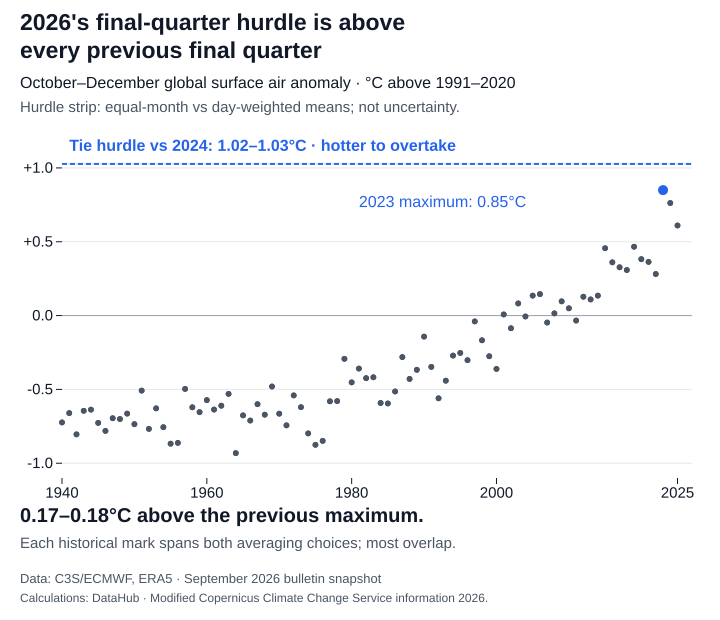

For 2026 to overtake 2024 in this calculation, October–December would have to exceed a tie hurdle of **1.02–1.03°C above 1991–2020**. That is **0.17–0.18°C above the warmest previous final quarter** in the ERA5 monthly record.

The ranges compare two ways of averaging: giving each month equal weight, or weighting it by its number of days. They show sensitivity to that choice, not physical uncertainty. A new record requires exceeding the unrounded hurdle; reaching the rounded label does not settle the comparison.

The [Copernicus Climate Change Service's September bulletin](https://climate.copernicus.eu/surface-air-temperature-september-2026), released in October, supplies the timely question. It puts 2026 second for January–September and says a repeat of late 2023 would bring it close to 2024. The hurdle calculation gives that comparison a historical scale.

These are global surface air temperature anomalies from C3S/ECMWF's ERA5 series, with observations through September 2026. Each month is compared with its own 1991–2020 average. A high anomaly means warmth relative to the same time of year; it does not mean the closing months must be the hottest months in absolute temperature. This is global air temperature across land and ocean, rather than local weather or sea surface temperature.

The highest previous October–December anomaly was **0.85°C in 2023**. Matching that final quarter would be insufficient because the annual average also carries the earlier months. January–September 2026 averaged **0.62°C**, behind 2024's **0.70–0.71°C**. The remaining quarter must offset that accumulated deficit as well as match the annual benchmark.


Yet the repeat scenario would leave only a small annual gap: **0.67–0.68°C for 2026**, compared with **0.72°C for 2024**, a difference of **less than 0.05°C**. C3S's “close to” comparison is consistent with this result. Second through September is already a warm year in this record.

A historical maximum is a comparison, not a ceiling. C3S also reports strengthening El Niño conditions; these anomaly calculations do not test that outlook or assign a probability to a new annual record. Nor does a single year's ranking measure the Paris Agreement's long-term warming level.

## How this was made

The [frozen monthly data](https://datahub.io/blog/2026-temperature-record-hurdle/_r/-/2026-temperature-record-src/global-monthly.csv), [provenance and licence](2026-temperature-record-src/PROVENANCE.md), [calculation](https://datahub.io/blog/2026-temperature-record-hurdle/_r/-/2026-temperature-record-src/calculate.py) and [chart builder](https://datahub.io/blog/2026-temperature-record-hurdle/_r/-/2026-temperature-record-make-charts.mjs) reproduce the numbers. Both averaging choices use the supplied anomalies and actual calendars. This is a conditional calculation on that snapshot, rather than a reproduction of C3S's eventual annual classification. From this download folder, run:

```sh
python3 2026-temperature-record-src/calculate.py
npm ci
node 2026-temperature-record-make-charts.mjs
```
