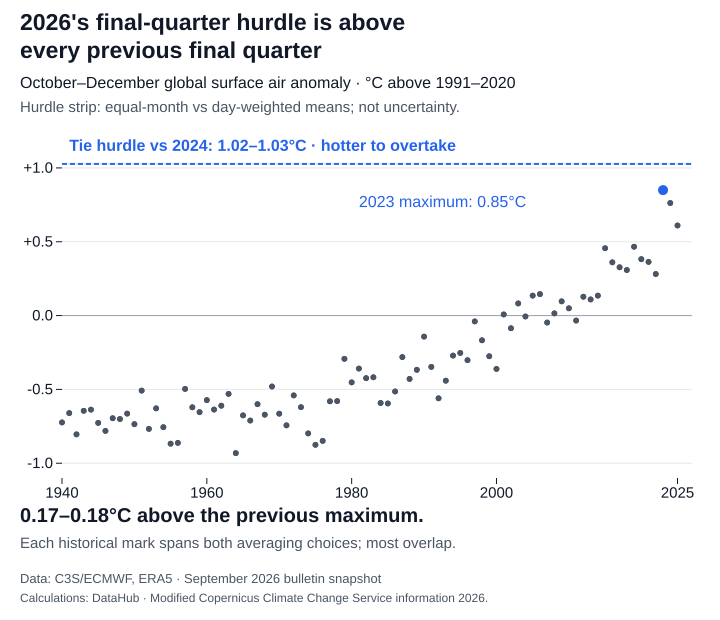

Even if 2026 repeated the warmest October–December in the record, it would still fall short of 2024's annual temperature record. That is a scenario using global surface air temperature observations through September, not a forecast. The reason lies in the nine months already counted: an exceptional finish cannot erase them from the annual average.

Here, warmth means an anomaly: how far each month's global air temperature across land and ocean was above its own 1991–2020 average. It is not local weather, sea surface temperature or a comparison of absolute summer and winter temperatures. The observations come from C3S/ECMWF's ERA5 monthly series, which begins in 1940.

January–September 2026 averaged **0.62°C above that baseline**, behind **0.70–0.71°C** for the same months of 2024. The range comes from giving each month equal weight or weighting it by its number of days; it is sensitivity to that choice, not physical uncertainty. Only three months remain to offset a deficit built up over nine.

The warmest previous final quarter was in 2023, at **0.85°C above the baseline**. Repeating those three monthly anomalies would lift 2026's annual average to **0.67–0.68°C**, still below 2024's **0.72°C**. The chart follows the average as each month is added; the shaded portion supplies the hypothetical finish for 2026, while 2024 remains observed throughout.


Falling short would still mean finishing close: the annual gap in this scenario is **less than 0.05°C**. The [Copernicus Climate Change Service's September bulletin](https://climate.copernicus.eu/surface-air-temperature-september-2026), released in October, puts 2026 second for January–September and says a repeat of late 2023 would bring it close to 2024. Both can be true: 2026 can be an unusually warm year without taking first place.

What would it take to close the gap? October–December would have to average **1.02–1.03°C above 1991–2020** just to tie 2024 in this calculation. That hurdle is **0.17–0.18°C above the warmest previous final quarter**. These ranges again compare the two averaging choices. A new record requires exceeding the unrounded tie hurdle; reaching the rounded label does not settle the comparison.



An annual ranking does not measure the Paris Agreement's long-term warming level. Nor does this arithmetic test the strengthening El Niño conditions reported by C3S or tell us what comes next. It establishes the scale of the required finish: a new annual record would need an unprecedented final-quarter anomaly in this series. History supplies the comparison, not a ceiling or a probability.

## How this was made

The [frozen monthly data](https://datahub.io/blog/2026-temperature-record-hurdle/_r/-/2026-temperature-record-src/global-monthly.csv), [provenance and licence](2026-temperature-record-src/PROVENANCE.md), [calculation](https://datahub.io/blog/2026-temperature-record-hurdle/_r/-/2026-temperature-record-src/calculate.py) and [chart builder](https://datahub.io/blog/2026-temperature-record-hurdle/_r/-/2026-temperature-record-make-charts.mjs) reproduce the numbers. Both averaging choices use the supplied anomalies and actual calendars. This is a conditional calculation on that snapshot, rather than a reproduction of C3S's eventual annual classification. From this download folder, run:

```sh
python3 2026-temperature-record-src/calculate.py
npm ci
node 2026-temperature-record-make-charts.mjs
```
