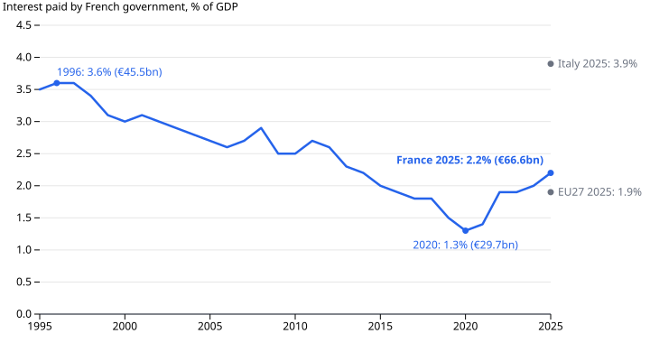

# France Has Borrowed Every Year Since 1995

French public debt reached 119.0% of GDP in mid-2026, about €3.6 trillion. In 2000 it was 60.5%. It jumped by 14.3 points in 2009 and by 16.7 points in 2020, and neither jump was undone. Between them, through the 2010s, it climbed another 14.1 points. After 2020 it dipped to 109.5% at the end of 2023, then rose again.

The two jumps coincide with the global financial crisis and the pandemic. Behind the jumps and the climb in between is one constant: in no year since 1995 has the French government raised as much as it spent.

## What these numbers are

Debt is INSEE's quarterly Maastricht measure: what the state, local authorities and social security funds owe, in nominal euros, as a share of a year's GDP. Everything else comes from Eurostat's annual government accounts, whose French series start in 1995; they say nothing about the years before. Revenue counts taxes, social contributions and sales. Spending counts everything from pensions to interest. The balance is revenue minus spending.

## Thirty-one deficits in a row

France has run a deficit in every year from 1995 to 2025. Its best year was 2000, at 1.3% of GDP. Germany ran surpluses from 2014 to 2019, reaching 1.9% in 2018. In 2025 France's deficit of 5.1% was the largest of the five economies here. Italy and the EU27 as a whole were at 3.1%, Germany 2.7%, Spain 2.4%.

The EU27 has not balanced its books in any of these years either. France is not alone in borrowing every year. It is unusual in how much.

## Not low taxes: higher spending

The deficit does not come from a light tax burden. In 2025 French government revenue was 52.1% of GDP, 5.7 points above the EU27 average. Spending was 57.2%, 7.7 points above. Two items make up most of that gap: cash social benefits such as pensions and unemployment pay (2.9 points), and the pay of public employees (2.1 points).

INSEE puts social protection, excluding health, at 41% of public spending in 2024, or €693bn, and notes that many benefits are indexed to past inflation ([Insee Première 2093](https://www.insee.fr/fr/statistiques/8735252), [2106](https://www.insee.fr/fr/statistiques/8997691)). The accounts measure the gap. They do not show which choices produced it.

## The bill that grows with the debt

Interest is where the debt feeds back into the yearly deficit. France paid €29.7bn in 2020 and €66.6bn in 2025, more than twice as much. As a share of GDP it rose from 1.3% to 2.2%.

That is not yet high by past standards. France paid 3.6% of GDP in 1996, and Italy paid 3.9% in 2025. The deficit also narrowed in 2025, from 5.8% to 5.1%; INSEE attributes this mainly to faster revenue growth, including €23.0bn of new tax measures.

Whether all this adds up to a crisis is a judgment these accounts cannot make. They hold no bond yields, credit ratings or election results. What they show is a gap between spending and revenue that has not closed in three decades, and a debt that each shock has pushed up and that has never returned to its earlier level.

## How this was made

Data: [france-public-finances](https://github.com/datasets/datapressr/tree/main/datasets/france-public-finances), from Eurostat's government accounts (update of 21 July 2026) and INSEE's quarterly debt release of 29 September 2026. [`build.ts`](https://github.com/datasets/datapressr/blob/main/datasets/france-public-finances/build.ts) rebuilds the CSVs offline from archived, hash-checked snapshots, and [`france-debt-make-charts.mjs`](france-debt-make-charts.mjs) draws the charts from them; re-running both reproduces every number here. Interest is Eurostat's measure. INSEE's, which treats bank service charges differently, gives €64.7bn for 2025. The dataset is still marked "archived": its INSEE table parser awaits independent review. The argument and chart plan are in the [outline](france-debt-outline.md).
