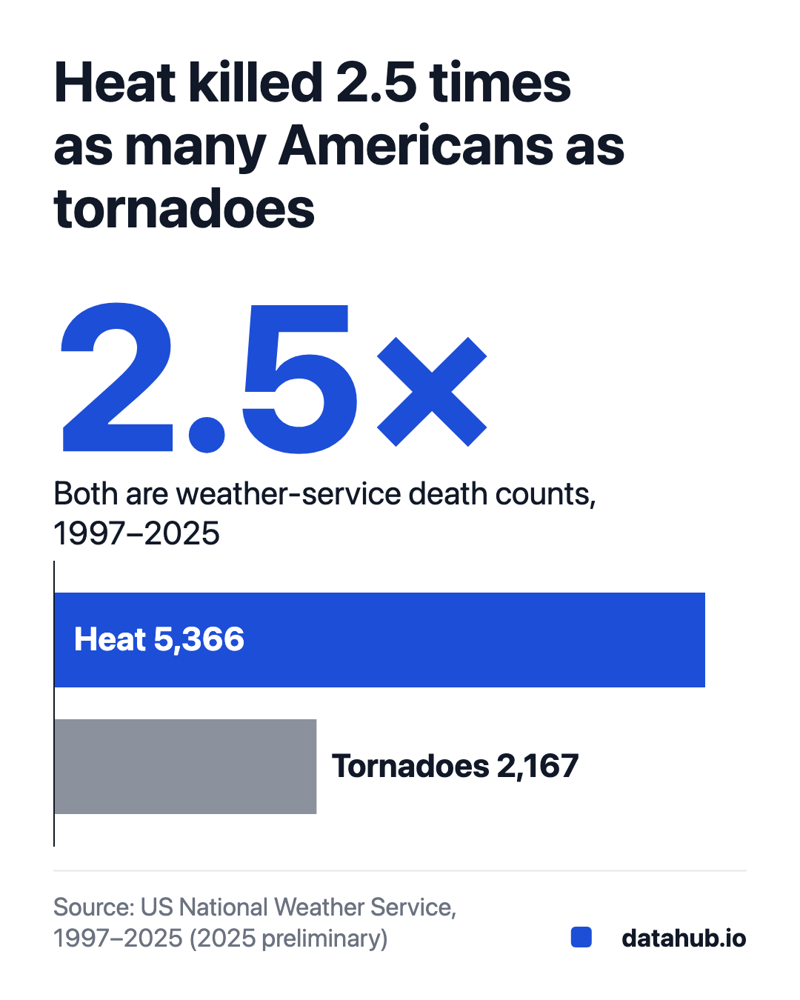

The story skill can now turn a story's key number or comparison into a social card (4:5, square or link-card size) with a hero number, source line and DataHub mark, sized to stay legible in a feed, and checks that cards and two-number comparisons follow the rules. Chart colours now meet contrast standards and stay distinct in greyscale and for colour-blind readers.

