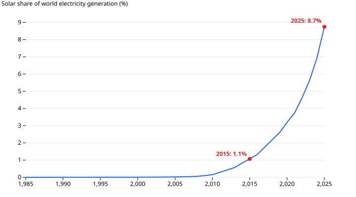
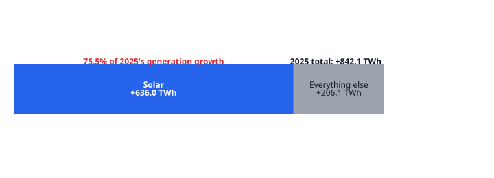
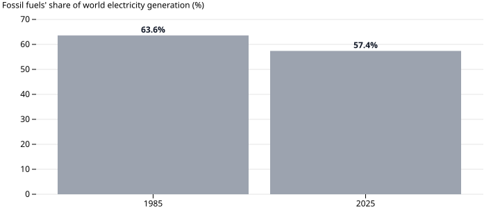

# Solar Overtakes Wind, and Climbs to 8.7% of World Electricity

*World electricity generation, all sources, 1985–2025. Data: [global-electricity-mix](https://github.com/datasets/datapressr/tree/main/datasets/energy-and-commodities/global-electricity-mix), from Our World in Data's energy dataset. Data story #8 — written from [an outline](solar-overtakes-wind-outline.md).*

In 2025 solar generated **2,778.6 TWh** of the world's electricity — more than wind, for the first time. Solar's share of world generation reached **8.7%**, up from 1.1% ten years earlier.

## What this is measuring

World electricity generation, all sources, one row per year, 1985–2025. Generation, not capacity: this counts electricity actually produced, not panels and turbines installed. Every figure below is a share or a change in that one world total — not any single country or grid.

## What the data says

Solar's 2025 generation was up **636.0 TWh** on 2024's 2,142.7 TWh. That is solar's own largest one-year rise in the series, and bigger than any single year's increase in wind generation — wind's biggest was +265.5 TWh, in 2021.

World generation grew by **842.1 TWh** in 2025. Solar's 636.0 TWh covered **75.5%** of that entire increase.

Solar overtook wind for the first time in the series: 2,778.6 TWh against wind's 2,713.1 TWh. As recently as 2024, wind was still ahead.

## The wrinkle

Fast growth from a small base is not dominance. Fossil fuels — coal, oil, gas — still generated **57.4%** of the world's electricity in 2025, down from 63.6% in 1985, but still well over half.

## Why, according to others

This dataset shows what happened, not why. Falling cost is the usual explanation. Auke Hoekstra's tracking of International Energy Agency forecasts found the IEA's 2010 outlook projected 294 gigawatts of cumulative installed solar capacity by 2030 — a level the world had already passed by 2016. Capacity and generation are different measures, so the two figures don't compare directly, but the direction matches: official forecasters have a long history of underestimating how fast solar grows. Ember attributes 2025's increase mainly to China, which it says installed the majority of the world's new solar capacity that year — again a capacity figure, not this story's generation measure.

## How this was made

Solar, wind and fossil figures come from [`global-electricity-mix`](https://github.com/datasets/datapressr/tree/main/datasets/energy-and-commodities/global-electricity-mix) in this repository, built by [`build.ts`](https://github.com/datasets/datapressr/blob/main/datasets/energy-and-commodities/global-electricity-mix/build.ts) from an archived snapshot of Our World in Data's energy dataset, filtered to the World rows. Re-running it reproduces every number above. The charts are built by [`solar-overtakes-wind-make-charts.mjs`](https://github.com/datasets/datapressr/blob/main/site/stories/solar-overtakes-wind-make-charts.mjs), which reads the same CSV.

The dataset splices two underlying sources — Ember's Yearly Electricity Data for recent years, the Energy Institute's Statistical Review of World Energy for earlier years — without an established handoff point between the two in this repository. 2025 is the series' most recent year and may still be revised.

## Friction notes

For the `story` skill:

- **A number the outline listed but never charted.** The fossil-share counter-number (beat 4) was in the approved outline's prose but not in its original three-chart plan. Writing the final prose surfaced the gap against the skill's "every number on a chart or exempt" rule — a fourth chart was the fix, added without a full re-review since the argument itself didn't change. Worth a note in the skill: check every outline number against the chart plan once more at the start of step 4, not only when the chart plan is written.
- **The independent review gate earned its keep twice over.** Round 1 caught a false "biggest increase for any source" superlative that the outline's own author had missed — solar's 2025 jump was smaller than the broader renewables and fossil categories' own biggest jumps. Round 2 caught a quieter error: "demand" used as a synonym for "generation" in several places, though the dataset has no demand series at all.
- **Exempt numbers** (not on a chart):
  - 294 GW, 2016: attributed IEA/Hoekstra figures (capacity, not this story's generation measure)
- **Author's voice pass: outstanding.** This prose is an AI draft rendered from the approved outline; the "sounds like me" pass has not been done.
